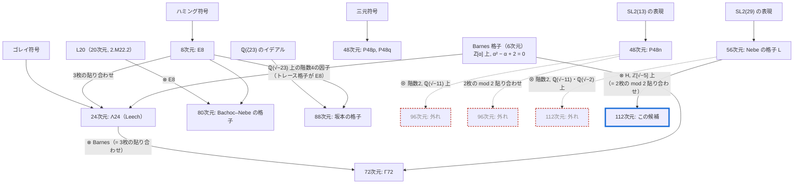

# 極値格子の系統 — 小さい格子がどう部品として使われてきたか

> 日本語のみ（This note is in Japanese only for now）。
> 構成の帰属の多くは、原論文ではなく [[Sak26, §1]](../README.ja.md#Sak26) などのサーベイと Nebe–Sloane のカタログによります（README §2.2 の注意と同じ）。

## 1. 系統図

上が低い次元、下が高い次元です。矢印は「この格子（または符号・群・体）を部品にして、下の格子を作った」を表します。点線は、この探索で試して外れた構成です。



この図に載せていないもの: 56・64次元の他の極値格子（Ozeki の三元符号からの56次元、Batut–Quebbemann–Scharlau の円分格子、Quebbemann の64次元など）、32・40次元の多数の格子。

## 2. 読み取れること

### 2.1 根は3種類しかない

高い次元の極値格子は、どれも次の3つの根から、1〜2段の「掛け算」で作られています。

- **符号**: ハミング符号、ゴレイ符号、三元の自己双対符号。
- **有限群の表現**: $\mathrm{SL}_2(p)$ などが既約に作用する格子（P48n、Nebe の56次元格子、80次元の一部）。
- **数体**: 円分体のイデアル格子（Γ72 は $\mathbb{Q}(\zeta_{91})$、88次元は $\mathbb{Q}(\zeta_{115})$ のイデアル格子としても書けます）。

### 2.2 E8 は「小さい相棒」として何度も使われている

$\Lambda_{24} = E_8 \otimes (\text{Barnes})$、80次元 $= E_8 \otimes L_{20}$、88次元も、4次元の因子のトレース格子が $E_8$ です。小さくて非常に密な格子が、もう一方の因子の「足りない密度」を補う役をしています。今回の $H$（実4次元）も、同じ「小さい相棒」の位置にいます。

### 2.3 「何枚貼るか」には天井がある

2枚または3枚の格子を mod 2 で貼り合わせる構成には、作れる最小ノルムに上限があります。

**補題.** $L$ を最小ノルム $m$ の偶格子とし、$R$ を $L$ の $k$ 枚のコピーから作った格子で、すべての $y \in L$ について $\tfrac{1}{\sqrt 2}(0, \dots, 0, 2y, 0, \dots, 0) \in R$ となるものとする。このとき $\min(R) \le 2m$。

*証明.* $y$ を $L$ の最小ベクトルに取ると、上のベクトルのノルムは $\tfrac12 \langle 2y, 2y \rangle = 2\langle y, y \rangle = 2m$。∎

この条件は、今回の2枚の貼り合わせ $R = \lbrace \tfrac{1}{\sqrt 2}(x, x\tau + 2y) \rbrace$ で $x = 0$ と置けば成り立ち、Quebbemann の構成 $L(M, N, k)$（3枚のときが Turyn 型。Γ72 はこれ）でも成り立ちます（後者は Nebe の Turyn 型構成の論文の補題による。原文は未確認）。

$n$ 次元の格子 $L$ から $kn$ 次元の極値格子を作るには、$\mu(kn) \le \min(R) \le 2\min(L) \le 2\mu(n)$、つまり

```math
\mu(kn) \le 2\mu(n), \qquad \mu(n) = 2\left\lfloor \frac{n}{24} \right\rfloor + 2
```

が必要です。$n = 24q + r$（$r \in \lbrace 0, 8, 16 \rbrace$）と書くと、$2\mu(n) = 4q + 4$ に対して $\mu(2n) = 4q + 2$（$r = 0, 8$）または $4q + 4$（$r = 16$）、$\mu(3n) = 6q + r/4 + 2$ です。したがって（[`verify/ceiling.py`](../verify/ceiling.py) で $n < 100000$ について確認）:

| 枚数 $k$ | $kn$ 次元の極値格子が作れる可能性がある $n$ | 余裕なし（$\mu(kn) = 2\mu(n)$） |
|---|---|---|
| 2 | **すべての $n$** | $n \equiv 16 \pmod{24}$（16, 40, 64, 88, 112, …） |
| 3 | $n = 8, 24$ だけ | 両方 |
| 4 | $n = 8$ だけ | — |

- **3枚の系統は72次元で行き止まり**です。$E_8$（8次元）から $\Lambda_{24}$、$\Lambda_{24}$（24次元）から Γ72 の2回しか使えず、どちらも天井ちょうどです。32次元の格子を3枚貼って96次元を作る方法は、天井が8で、必要な10に届きません。
- **2枚の系統は、どの次元でも天井に当たりません。** 今回の 112 = 2 × 56 は天井12に対して必要10で、余裕が2あります。余裕がなくなるのは $n \equiv 16 \pmod{24}$ のとき（64 → 128、88 → 176 など）です。

## 3. 失敗した構成が記録していること

| 試した構成 | 結果 | 何が外れたのか |
|---|---|---|
| 96 = P48n ⊗（階数2のエルミート格子）, $\mathbb{Q}(\sqrt{-11})$ 上 | 4つの構造すべてにノルム8 | 虚二次体の構造による2枚の系統 |
| 96 = P48n の2枚の mod 2 貼り合わせ（群の中心の元・成分を混ぜる元による） | すべてノルム8 | 群の中心から来る貼り方 |
| 96 = 32次元の3枚の貼り合わせ | 試すまでもなく不可能 | 天井（§2.3） |
| 112 = Nebe の56次元格子 ⊗（階数2）, $\mathbb{Q}(\sqrt{-11})$, $\mathbb{Q}(\sqrt{-2})$ 上 | 4つとも即座にノルム6 | 貼り方が単数と mod 2 で一致してしまう |
| 112 = 同じ格子の2枚の貼り合わせ、四元数環の元 $\tau$（$\tau^2 = -5$）による | 2類のうち1類がノルム8、**1類が候補** | — |

当たった貼り方は、虚二次体の構造ではなく、**$\mathrm{SL}_2(29)$ と可換な自己準同型の環（$\mathbb{Q}(\sqrt{29})$ 上の四元数環）の元**から来ています。96次元では、この型の貼り方はまだ試していません。

## 4. ここから見える今後の方向（推測）

いずれも見込みの話で、確かめたものではありません。

- **96次元: P48n で「四元数型の $\tau$」を探す。** P48n も Nebe の四元数的な構成から来る格子です。群と可換な自己準同型で $\tau^2$ が負の整数になるものを探し、2枚の系統をやり直す価値があります。手順は112次元とほぼ同じです。ただし Siegel 平均余剰は96次元のほうが約300倍大きいので、見込みは112次元より厳しいはずです。
- **160次元: 80次元の格子2枚。** 2枚の系統で余裕があり（天井16に対して必要14）、80次元の格子の自己同型群は非常に大きい（約 $4.5 \times 10^9$、カタログの値）。ただし貼り合わせの後に残る対称性は、群のうち $\tau$ と可換な部分だけです。
- **他の56次元格子での112次元。** Ozeki や Batut–Quebbemann–Scharlau の56次元格子に同じ型の構造があれば、別の候補が出るかもしれません。
- **3枚以上の系統は、24次元より上では使えない**ので、探す対象から外してよい、というのが §2.3 の帰結です。
