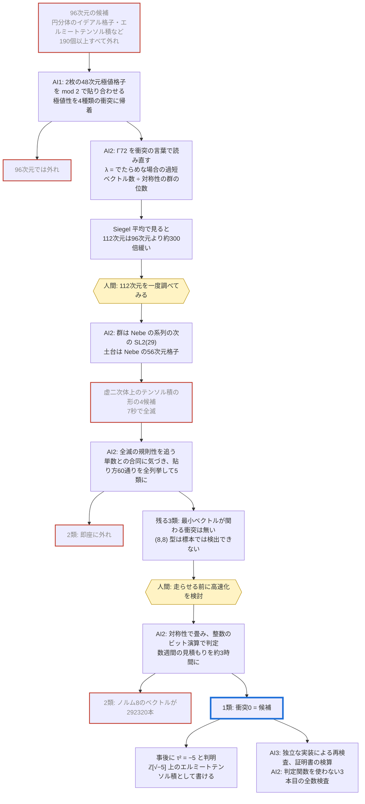

# ここに至るまで / How we got here

> 経緯の覚え書きです（日本語のみ。This note is in Japanese only for now）。まだ骨子の段階で、順次書き足します。
> 元になる記録（調べた候補の一覧表、失敗の記録、AI の各セッションの作業日誌）は非公開の作業用リポジトリにあります。ここには、第三者が判断するのに要る範囲だけを移します。

## 1. 動機
- OpenAI による [openai/math](https://github.com/openai/math)の公開。
- Codex (GPT-6 Astra)により、個人的な未解決問題に証明が与えられることを体験。
- 構成が主体の未解決問題を AI agent に渡してみようと考える。
- 88次元の極値偶ユニモジュラー格子の構成が2026年9月に ChatGPT の助けを借りてなされたと知る [[Sak26]](../README.ja.md#Sak26)。
- この問題との出会い。原田昌晃「72次元の極値偶ユニモジュラー格子」（数学セミナー2012年1月号、特集「『想定外』の数学」）。

## 2. 進め方
- 人間が方向を決め、AI（Claude）の複数のセッションが並行して探索・計算・記録を行った。期間: 2026-10-12〜。
- 約束事: 計算で確かめただけのものを証明済みと書かない。短いベクトルが「見つからなかった」ことを証拠にしない。検査は、外れと分かっている格子で検出力を確かめてから使う。「見つけた」と思ったらまず疑い、独立に2回確かめる。

## 3. 外れた候補
- 96次元: 円分体 $ℚ(\zeta_m)$ の主イデアル格子12個、虚二次部分体の類73個、CM 部分体の類90個余り、$48 \times 2$ のテンソル積、$48 + 48$ の mod 2 の貼り合わせ。すべてノルム8以下を持つ。
- 104, 112, 120, 144次元の円分・テンソル型の候補（104次元の Thompson 型・Batut–Quebbemann–Scharlau 型を含む）。
- TODO: 調べた候補の一覧表（候補・見つかった最短ノルム・どこで見つけたか）を `docs/candidates.md` として移す。

## 4. 間違い・失敗（抜粋）
- 「内積の分布が途中で止まるのは良い兆候」と判断した候補が、基準率を見積もると単なる標本不足だった（96次元、$48 \times 2$）。
- 格子簡約（BKZ）の「通過」を信じかけた。既知の外れで較正すると検出力が無かった。
- イデアル類の「新しい候補」の8割が、上の体で単項化して既知の格子と同じものだった。
- 112次元の候補でも、固定部分格子の検査と BKZ は外れの対照を検出できず、証拠にならなかった。

## 5. なぜ112次元か
- Siegel 平均による見積もり（README §6）。96次元より112次元のほうが、必要な対称性が約300分の1で済む。

## 6. 候補の発見と検証の経過
- 2026-10-13: $\mathrm{SL}_2(29)$ を保つ貼り合わせ5類の列挙。2類が即座に外れ。
- 同日: 最小ベクトルが関わる衝突が3類とも無いことを確認。$(8,8)$ 型の全数検査を設計。
- 同日夜: 2類でノルム8が $`292\,320`$ 本、1類で衝突0。$\tau^2 = -5$ と判明。
- 2026-10-13〜14: 別セッションによる独立な確認（README §4の「誰が」の列）。
- 2026-10-14: 3本目の全数検査（標準形も群も使わず、最近ベクトルの計算で152万組すべてを調べるもの）が完了。衝突0。

## 6.5 道筋の図

候補に至るまでの道筋です。外れた枝も残しています。六角形は人間の判断、赤い枠は外れ、太枠が候補です。

**登場する AI**

| 記号 | 何をしたか | システム |
|---|---|---|
| AI1 | 96次元で、mod 2 の貼り合わせと4種類の衝突の枠組みを作った | OpenAI Codex（モデル名: GPT-6 Astra） |
| AI2 | 物差し λ、112次元の貼り合わせの全列挙、全数検査、τ² = −5 の発見、3本目の全数検査 | Claude（Anthropic）、Claude Code 上のセッション（モデル名: Opus 5.5） |
| AI3 | 96〜112次元の円分体のイデアル格子の探索、候補の独立な再検査、このリポジトリの下書き | Claude Opus 5.5（Anthropic）、Claude Code 上のセッション |

ほかにも、用語の整理や極値格子の局所構造の定理などを担当したセッションがあり、背景として使っています。

既知の極値格子との関係（どの小さい格子を部品にしたか）は [genealogy.md](genealogy.md) にまとめました。

## 7. 人間の寄与と AI の寄与
- 人間（roiban1344）: 問題の選択、方向づけ、判断。
- AI（Claude）: 探索、コード、計算、検証、文章の下書き。
- 詳しくは追って書きます。
